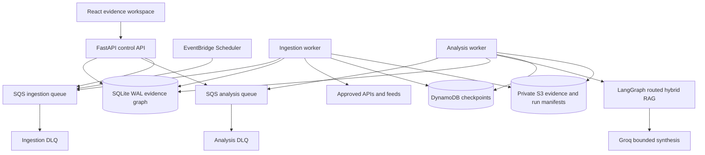

# Atlas architecture upgrade

## What was learned from the reference agent

The reference system demonstrates useful production patterns: scheduled multi-source collection, explicit source tiers, temporal facts, durable checkpoints, separate analytical stages, dead-letter recovery, retrieval routing, graph retrieval, and operational health checks. Atlas adopts those patterns where the implementation can support them now. The implemented LangGraph and retrieval decisions are documented in [LangGraph and hybrid RAG architecture](LANGGRAPH_RAG_ARCHITECTURE.md).

Atlas does not copy claims such as “zero hallucination,” “100% coverage,” or “formal verification” because an LLM, a source scraper, and passing unit tests cannot establish those guarantees. It also avoids silent mock data, committed runtime databases, long-lived AWS keys in CI, and a large dependency graph before the data path needs it.

## Runtime topology

The API remains responsive while collection and analysis run in separate containers. SQS leases jobs, retries transient failures and moves poison messages into source-specific dead-letter queues. DynamoDB stores append-only state transitions with 90-day TTL. S3 stores encrypted run manifests and consistent SQLite backups. The scheduler is disabled until the containers pass their health checks.

## Evidence policy

Every collected item receives a deterministic provenance envelope before model use:

| Class | Tier | Routing prior | Meaning |
|---|---:|---:|---|
| Primary regulatory | 1 | 0.98 | Direct official filing |
| Issuer disclosure | 1 | 0.95 | First-party company disclosure |
| Official public record | 1 | 0.93 | Government or regulator record |
| Official social statement | 2 | 0.78 | Statement attributable to an official account |
| User reviewed | 2 | 0.80 | User confirms the cited source supports the recorded statement |
| Reporting lead | 3 | 0.60 | Discovery lead requiring primary verification |
| Open-source discovery | 4 | 0.45 | Route or index lead with uncertain completeness |
| Synthetic | 9 | 0.00 | Demonstration data only |

The routing prior orders review and retrieval. It is not a probability that a claim is true. Material graph edges still require precise evidence, entity resolution, effective time, observation time and review state.

## Operations without CloudWatch

- Docker JSON logs rotate at 10 MB with five files per container.
- `Atlas-Intelligence-Status` reports container health and live/DLQ queue depth through SSM.
- `Atlas-Intelligence-Backup` creates a consistent SQLite backup and uploads it to private S3.
- DynamoDB records job state transitions and expires them after 90 days.
- S3 stores compact run manifests with lifecycle expiration.
- The health endpoint reports whether durable ingestion and analysis are configured.
- API and worker containers fetch the runtime JSON directly from Secrets Manager through the EC2 IAM role; the deployment host does not persist secret values in its environment file.

This avoids a continuous log-ingestion bill. The tradeoff is that long-term searchable application logs are unavailable; run manifests and evidence provenance remain the durable audit records.

## Cost controls

- SQS uses long polling and AWS-managed encryption.
- DynamoDB uses on-demand billing, AWS-owned encryption and TTL.
- EventBridge scheduling is off until deployment is verified.
- No NAT Gateway, Kubernetes, OpenSearch, Neptune, RDS or CloudWatch log ingestion is introduced.
- Existing EC2, private S3, ECR and Secrets Manager resources are reused.

## Scale boundaries

SQLite remains appropriate for one host and a small number of serialized workers. Move normalized records to PostgreSQL when writers must scale across hosts, sustained lock contention appears, or temporal graph queries require indexed relational joins. Move workers to ECS only when queue backlog and processing latency justify horizontal scaling. Add a vector store only after measured retrieval quality shows keyword, temporal and graph retrieval are insufficient.
