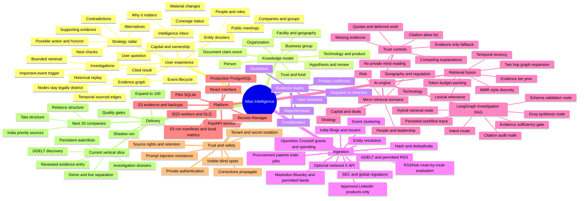
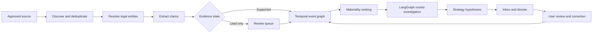
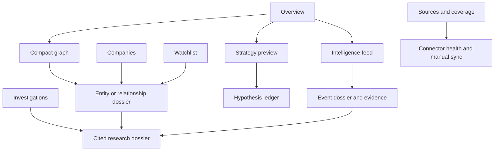

# Atlas implementation mind map

This map represents the operational knowledge system, not merely a presentation diagram. Import this Markdown into Xmind, or render the Mermaid map below in compatible Markdown tools.

This is the full product blueprint, including planned connectors and models. For the implemented data flow, current capabilities and remaining limits, see [IMPLEMENTED_UPGRADE.md](IMPLEMENTED_UPGRADE.md).

The [V2 strategy and business-gap plan](STRATEGY_INTELLIGENCE_V2_PLAN.md) adds the business-unit/capability/portfolio knowledge map and an implementation DAG for strategic and opportunity analysis.

## Event-to-insight flow

## Frontend navigation

