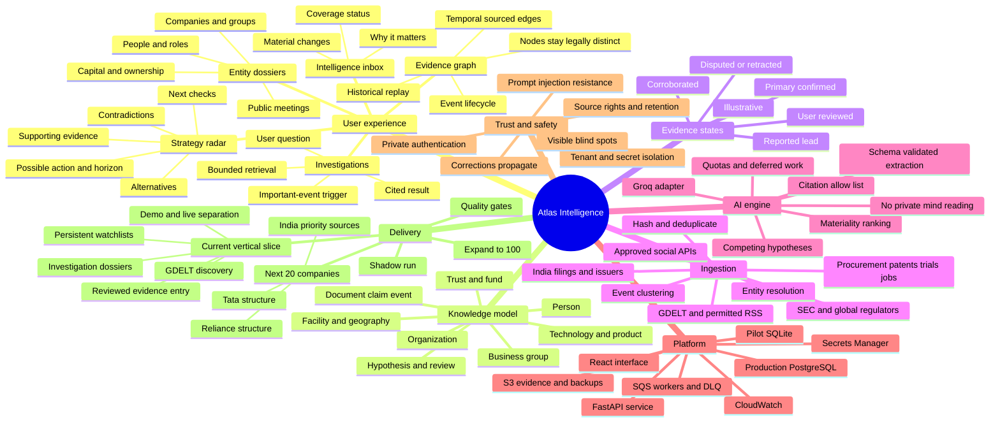
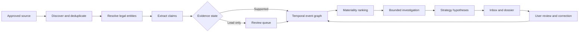
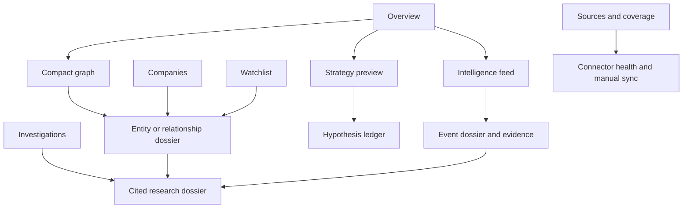

# Atlas implementation mind map

This map represents the operational knowledge system, not merely a presentation diagram. Import this Markdown into Xmind, or render the Mermaid map below in compatible Markdown tools.

## Event-to-insight flow

## Frontend navigation

