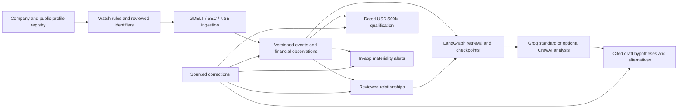

# Implemented registry and live-research upgrade

Updated 31 October 2026. This document describes executing code and its limits. The canonical checkout is `/Users/apple/Downloads/strategy-mapping`, with remote `https://github.com/techieguy-kartik/mind-map.git`. The separate research-agent project is a reference only.

## Registry

`server/data/company_registry.json` contains 1,372 distinct Wikidata candidates and 100 memberships in each of 15 broad discovery portfolios. The original local companies and Indian group entries remain. A company can belong to multiple portfolios. Portfolio membership does not establish niche capability: Quantum & Advanced Compute includes semiconductor companies; Spatial & Space Intelligence includes space-industry companies; Aerospace & Defence does not certify defence-AI activity.

The snapshot is CC0 source data with per-company Wikidata links, source revision when available, aliases and a generation timestamp. It is an identity/discovery catalog, not a financial eligibility list. Current operating status, country attribution, ownership and the USD 500M threshold still require primary verification.

The startup migration runs offline, hashes the snapshot, preserves existing local IDs/notes/watchlists, and avoids overwriting user-maintained fields. Existing SQLite databases expand after restart. Startup never queries Wikidata. To regenerate the snapshot intentionally:

```bash
.venv/bin/python scripts/build_company_registry.py
```

The builder uses an ignored resumable fetch cache, bounded requests, a company-type filter and source-error reporting. Inspect the catalog diff before committing a new snapshot.

Frontend: Companies now has sector and country filters, 50-row pages, provenance links and portfolio coverage/gaps. Server API supports `GET /api/companies?q=&sector=&country=&offset=0&limit=50` and `GET /api/registry/coverage`.

## Latest reporting and historical research

New live investigations default to `refresh_sources=true`. LangGraph checks the selected company's collection age for each source in its monitoring rule (GDELT by default). Fresh collections use the cache; stale or unknown collections invoke the corresponding fixed-host adapter. Shared SQLite cooldowns coordinate API and workers. Outages and cooldowns remain visible in `acquisition`, with per-source freshness and partial coverage.

The freshness timestamp means a successful collection check, not complete coverage or guaranteed real-time publication. GDELT discovers news; SEC and NSE adapters collect official records. Demo investigations do not request live data.

An optional `as_of` timestamp filters publication/effective and observation times before retrieval and graph expansion. It disables refresh. SQLite triggers retain versions of events, relationships, hypotheses and financial observations; historical retrieval selects the latest version known at the cutoff. This preserves pre-correction records. Migration backfills the currently available version; it cannot recover revisions before this upgrade. This is a pilot version store, not a complete claim-level bitemporal model.

API example:

```json
{
  "entity_id": "jio",
  "question": "What changed and which evidence supports a possible strategic shift?",
  "demo": false,
  "refresh_sources": true,
  "analysis_mode": "standard",
  "as_of": null
}
```

## Primary disclosures and financial qualification

`server/primary_sources.py` implements fixed-host [SEC submissions and companyfacts](https://www.sec.gov/search-filings/edgar-application-programming-interfaces) and five official [NSE RSS feeds](https://www.nseindia.com/static/rss-feed): announcements, financial results, board meetings, shareholding and annual reports. Sources & coverage exposes manual collection; AWS ingestion workers accept the same source jobs. A live check in an isolated temporary database collected 32 SEC filing records and one annual-profit observation for Tesla. The NSE announcements request succeeded but returned no matching Reliance record; this says nothing about activity outside that feed.

SEC identification uses an exact normalized issuer-name match against its directory, or an explicitly reviewed CIK mapping in the dossier. Ambiguous or missing matches fail visibly. `SEC_USER_AGENT` must identify the application and contact; load it through the existing Secrets Manager runtime secret. Recent supported filing metadata is imported with original links; metadata does not establish a completed deal. Annual `us-gaap:NetIncomeLoss` USD facts are extracted separately; quarterly results, revenue and market capitalization are not substituted. IFRS/custom-taxonomy extraction and complete archival ingestion are not implemented.

NSE shares feed caches across companies, rejects entity declarations and oversized XML, and matches registered names/aliases. Feed types have separate company watermarks, so checking ownership does not mark announcements fresh. RSS descriptions are metadata rather than parsed PDF evidence. Coverage and ambiguous/short aliases still need review.

`server/financials.py` evaluates **valuation OR annual net profit strictly greater than USD 500M** from dated observations. Non-USD observations require a supplied FX rate and a source dated within seven days. Valuations expire after 120 days and annual-profit observations after 550 days: explicit pilot policies. A reviewed form supports Indian and other companies without inventing conversion rates. Qualification appears in dossiers, workspace and paginated company API. Most catalog candidates remain unverified until evidence is collected.

Each observation becomes a citable research event. Disputing or retracting that event removes its observation from financial qualification. Source-backed qualification is not an independent audit.

## People, monitoring, alerts and corrections

People & capital lists distinct people, funds and trusts and supports adding sourced public profiles, companies and technologies. Existing reviewed graph evidence links entities with dated relationships; current leaders and owners are not inferred from profile names.

Company dossiers configure monitoring enablement, priority, desired cadence, source set and minimum alert materiality. The API also supports event-type filters. The disabled-by-default AWS schedule now proposes a five-minute tick. Each tick fans out due company/source jobs, honors source-specific last success, prioritizes higher-priority companies and caps dispatch at `ATLAS_SCHEDULE_BATCH_SIZE` (default 100). Actual cadence remains constrained by source cooldowns, queues and scheduler activation.

New matching non-demo events create deduplicated **in-app** alerts. Their 1–5 scores are explainable keyword heuristics, not calibrated impact predictions. No external messages are sent. Alert generation follows event persistence and is not a transactional notification outbox.

The evidence dossier supports sourced review, dispute and retraction. It preserves the prior record, updates dependent relationships, flags supported hypotheses for review and withdraws or marks existing alerts. Current retrieval and graph views exclude disputed/retracted records; historical research can use the pre-correction version. Sentence-level contradiction and entailment checks remain future work.

## Optional real CrewAI team

`server/intelligence/crew.py` executes three sequential CrewAI tasks: capital analyst, sector analyst, and skeptical editor. Each receives the bounded raw evidence packet and structured predecessor outputs. It uses Pydantic reports, citation allowlists, no tools, no recursive delegation, one agent iteration, zero guardrail retries, provider timeouts and per-agent execution limits. Memory, caching, verbose output and tracing are disabled. LangGraph performs final validation after the team returns.

CrewAI is pinned to the tested 1.9.3 release. The newest release requires an unavailable LanceDB dependency on this Intel Mac; CrewAI also requires Python below 3.14. The ordinary Atlas image stays on Python 3.14. `Dockerfile.crew` uses Python 3.13 and a separate tested dependency lockfile. Real-framework tests use a deterministic model: three tasks produced three calls, and an invented citation was rejected. These tests do not measure live Groq response quality.

Enable for AWS deployment by setting Terraform `crew_worker_enabled=true`, reviewing/applying the plan, and running the deployment document. It builds the optional worker image, uses it for the analysis queue and exposes the CrewAI selector in the API/UI. Secrets continue to load from Secrets Manager through the instance role. No infrastructure was applied during development.

For a local Python 3.13 process with CrewAI:

```bash
python3.13 -m venv .venv-crew
.venv-crew/bin/pip install -r requirements-crew.lock
AWS_PROFILE=account2 AWS_REGION=us-east-1 \
ATLAS_RUNTIME_SECRET_ID=/atlas/production/runtime \
ATLAS_CREW_ENABLED=true OTEL_SDK_DISABLED=true \
CREWAI_TELEMETRY_DISABLED=true CREWAI_TRACING_ENABLED=false \
.venv-crew/bin/python -m server.start
```

The standard Python 3.14 startup command continues to work, with standard analysis. Do not enable CrewAI in a process lacking the optional dependencies or route crew jobs to the standard analysis image.

## Live UI and strategy radar

SQLite transactions append small change records through triggers. Authenticated `GET /api/updates` streams invalidation events with monotonically increasing cursor IDs. The browser reconnects with `Last-Event-ID`, refreshes on change and retains a 15-second polling fallback. This streams committed application changes; it does not create an upstream news subscription. A browser test verifies an external watchlist mutation appears within eight seconds without reloading.

A completed cited AI investigation can be saved as a **Draft** in Strategy radar. The action is idempotent and carries its citations, alternatives, missing evidence and original investigation ID. Evidence-only inventories cannot be promoted into strategy claims.

## Reliability and operations

- Source failures and deferred analyses reach SQS retry/redrive rather than being acknowledged as success.
- Worker source requests wait through the shared cooldown with bounded retries; long jobs renew their SQS visibility lease.
- Completed analysis deliveries skip repeated inference.
- Provider failures retain retrieval evidence and stage traces.
- LangGraph checkpoints use `langgraph-checkpoint-sqlite` in the application database. An interrupted provider call resumes the saved graph node rather than repeating retrieval. Terminal failed/deferred attempts start a new graph attempt; completed SQS deliveries skip inference. Resume retains the evidence snapshot from the original attempt rather than silently refreshing it.
- API startup preserves jobs owned by durable workers.
- The deployment document fixes ownership of the mounted database directory for non-root containers.
- No CloudWatch or Bedrock service is added.

## Remaining roadmap

Verification on 31 October 2026: core backend 58 passed with one optional CrewAI module skipped; isolated CrewAI environment 60 passed; all 13 Chromium desktop/mobile workflows passed; frontend production build and Terraform format/validation passed. These are functional regression checks, not evidence of complete source coverage or evaluated prediction quality. The local Docker daemon was unavailable, but the standard image built successfully in [GitHub Actions run 41168030817](https://github.com/techieguy-kartik/mind-map/actions/runs/41168030817); all four CI jobs passed for implementation commit `039c5c0`. The optional CrewAI image is not built by that CI job and remains unverified as an image. No deployment or Terraform apply was performed.



Complete social ingestion, additional permitted issuer feeds, full-document/PDF parsing, automatic sourced leadership enrichment, claim-level temporal models and entailment, semantic retrieval evaluation, event clustering, external notifications, transactional alert delivery and PostgreSQL migration remain in `PRODUCT_UPGRADE_PLAN.md`. Access to X or LinkedIn is not assumed to provide free unrestricted monitoring. This product does not provide complete real-time global coverage or reveal private intentions. The standard container build passed CI; the optional CrewAI container build still requires separate validation. Deployment and Terraform apply remain owner-operated.
