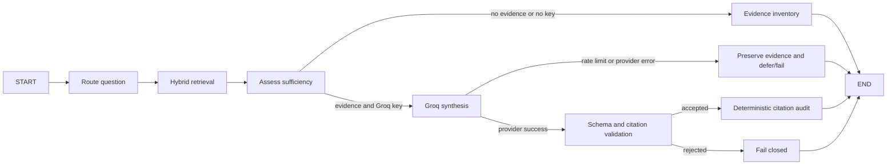

# Atlas LangGraph and hybrid RAG architecture

## Reference-agent review

The reference agent was reviewed at node, retriever, graph, context-packing, checkpoint, safety, and orchestration levels. The reusable ideas are its intent-based micro-RAG routing, semantic-plus-graph retrieval, bounded multi-hop traversal, temporal facts, context budgeting, evidence gaps, and alternatives.

Atlas deliberately does not reproduce the reference system's 24-node shape. Several registered nodes there are called manually inside one thread-pool node, while the executed graph remains largely sequential. Its “formal verification” is registry and string matching, its “Brier proxy” is not a Brier score, and several safety fallbacks accept missing model checks. Atlas uses narrower claims and tests every implemented gate.

## Executed investigation graph



These are actual LangGraph nodes and conditional edges in `server/intelligence/workflow.py`. Each completed node writes its current route, diagnostics, evidence, and trace to the investigation record so the API and UI can show progress.

## Retrieval design

1. **Intent routing** selects at most three of capital, people, technology, geography, risk, and strategy. It is deterministic and visible in the dossier.
2. **Lexical retrieval** scores query overlap against event title, summary, and event type.
3. **Temporal scoring** adds a bounded recency contribution with a 180-day decay. Recency cannot establish truth.
4. **Evidence routing** uses the existing source prior. This is a review-order input, not a factual probability.
5. **Graph expansion** traverses only the selected live or demo graph, at most two hops and 100 nodes.
6. **Diversity reranking** uses a transparent MMR-style relevance/redundancy calculation to reduce duplicate headlines.
7. **Context packing** sends only selected evidence within an estimated 3,200-token budget.

The current corpus is small enough for deterministic in-process retrieval. FAISS, OpenSearch, or a hosted vector store should be introduced only after a labeled retrieval evaluation shows a measurable improvement over this baseline. This prevents an embedding layer from hiding poor entity resolution or low-quality sources.

## Synthesis and audit contract

Groq receives a bounded context and must return:

```json
{
  "result": "public-evidence analysis",
  "citations": ["stored-event-id"],
  "alternatives": ["competing explanation"],
  "missing_evidence": ["specific verification gap"]
}
```

The workflow rejects an empty result, invented citation, missing alternative, missing evidence gap, or malformed type. The audit then reports cited evidence count, direct entity citations, primary or reviewed citations, and warnings. It does not claim that an LLM output is formally proven.

## Next measured upgrades

- Create a labeled company-question retrieval set and track recall@10, precision@10, duplicate rate, citation validity, and primary-source coverage.
- Add bitemporal `as_of` retrieval after event valid-time and observation-time indexes exist.
- Add issuer-filings and regulator adapters before increasing model complexity.
- Add an embedding retriever as a third candidate generator, then keep it only if the evaluation improves.
- Move normalized evidence and workflow checkpoints to PostgreSQL when writers span hosts; keep S3 for permitted raw artifacts and manifests.
- Add claim-level citation spans so each material sentence maps to its supporting records.
