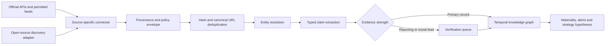

# Free and open-source ingestion plan

Verified 28 October 2026. Provider rules and prices change, so production connectors keep their own access-policy record and fail visibly when access changes.

## Access decision

X and LinkedIn are useful sources, but neither supplies the broad free monitoring access Atlas needs. X's current developer offering is pay per use; public post reads are metered. LinkedIn's self-service permissions cover sign-in and posting on behalf of an authenticated member. Reading arbitrary members or displaying a company-page feed is restricted or approval-based. Atlas therefore treats both as optional official connectors rather than pretending that a free key gives complete coverage.

Open-source software is useful for feed normalization, scheduling and extraction. It does not grant data rights. Every adapter must record its upstream source, route, terms, retention rule, rate limit, last success and known blind spots.

## Connector order

| Priority | Source family | Cost/access | What it establishes | Implementation |
|---|---|---|---|---|
| P0 | Company investor relations, press releases, RSS/Atom | Free public pages/feeds | First-party announcements | Feed allow-list, conditional GET, content hash and original URL |
| P0 | SEC EDGAR submissions and XBRL | Free official API | US filings, ownership and financial facts | CIK registry, filing metadata first, form-specific parsers |
| P0 | NSE/BSE/SEBI and issuer disclosures | Public; validate automation rules | Indian listed-company disclosures | Exchange-specific adapter and legal-entity mapping |
| P0 | GDELT DOC API | Free public API | Global reporting discovery | Implemented as headline leads |
| P1 | Patents: USPTO, EPO OPS, WIPO where available | Free or quota-limited official services | Technology direction and assignees | Applicant resolution plus patent-family deduplication |
| P1 | Grants and trials: NIH RePORTER, ClinicalTrials.gov, EU portals | Free official APIs | Research funding and clinical activity | Sponsor/recipient mapping and phase/status events |
| P1 | Procurement: USASpending, SAM.gov and national portals | Free official APIs; some require free keys | Awards, buyers, suppliers and amounts | Award lifecycle and parent/subsidiary resolution |
| P1 | OpenAlex, Crossref and ORCID | Free/open APIs | Papers, authors and institutional relationships | DOI deduplication and affiliation confidence |
| P1 | Mastodon and Bluesky | Public APIs, instance/service policies apply | Public posts from monitored official accounts | Account allow-list, cursor checkpoints and deletion handling |
| P2 | RSSHub | AGPL open-source adapter; route reliability varies | Discovery from sources without native feeds | Self-host pinned image, test each route, store original URL, never bypass access controls |
| P2 | X official API | Metered reads | Public posts from selected accounts | Daily spend cap, post-ID deduplication and deletion compliance |
| P2 | LinkedIn approved products | Approval and use-case restrictions | Only data allowed by granted product/scopes | OAuth, scope ledger and no off-platform company-feed display |
| P3 | Job boards and career APIs | Site-specific | Hiring demand and capability signals | Aggregate roles; respect robots, terms and retention |

## Open-source components

- **RSSHub** for route-based discovery when the upstream permits collection. Pin an immutable container digest and track route failures.
- **feedparser** or a small hardened RSS/Atom parser for native feeds. Reject non-HTTP URLs, cap response size and block redirects outside an allow-list.
- **Scrapy** only for approved sites that lack an API/feed. Use per-domain throttles, cache validators and a collection register.
- **Apache Tika** for permitted PDF/document text extraction, isolated from the API process.
- **OpenSearch** only after the corpus needs full-text retrieval; PostgreSQL remains the system of record.
- **OpenTelemetry** for connector latency, rate-limit, freshness and failure metrics.

## Evidence pipeline

Each record carries `source_id`, original URL, upstream item ID, author/account, publication and observation times, retrieval method, content hash, evidence class, language, legal entity candidates, correction/deletion state and connector version. Social posts are statements by an account; they do not automatically prove a company action, meeting, investment or intention.

## Collection controls

1. Maintain a monitored-account registry linking each company/person to official handles and evidence for that attribution.
2. Schedule primary disclosures first, news second and social last. This gives the strongest evidence the lowest latency.
3. Apply source-specific daily request and dollar caps. A connector stops before exceeding its budget.
4. Store raw bodies only where retention permits; otherwise retain metadata, hashes and original links.
5. Propagate edits, deletions, retractions and filing amendments to dependent graph claims and alerts.
6. Show coverage by source, country, language and time window. An empty feed never means no event occurred.

## AWS execution path

EventBridge Scheduler starts one connector job per source partition. SQS provides retries and a dead-letter queue. ECS/Fargate workers are preferable once scheduled collection begins; the current EC2 host can run the pilot workers. Connector secrets live in Secrets Manager, raw permitted objects in S3, normalized records in PostgreSQL, and CloudWatch/OpenTelemetry expose freshness, queue age, errors and spend. Groq receives only bounded evidence selected for extraction or synthesis.

## Access references

- [X Developer Platform pricing and access](https://developer.x.com/)
- [LinkedIn: Getting Access to APIs](https://learn.microsoft.com/en-us/linkedin/shared/authentication/getting-access)
- [LinkedIn Marketing API FAQ](https://learn.microsoft.com/en-us/linkedin/marketing/lms-faq)
- [Mastodon public timeline API](https://docs.joinmastodon.org/methods/timelines/)
- [RSSHub source and license](https://github.com/DIYgod/RSSHub)
