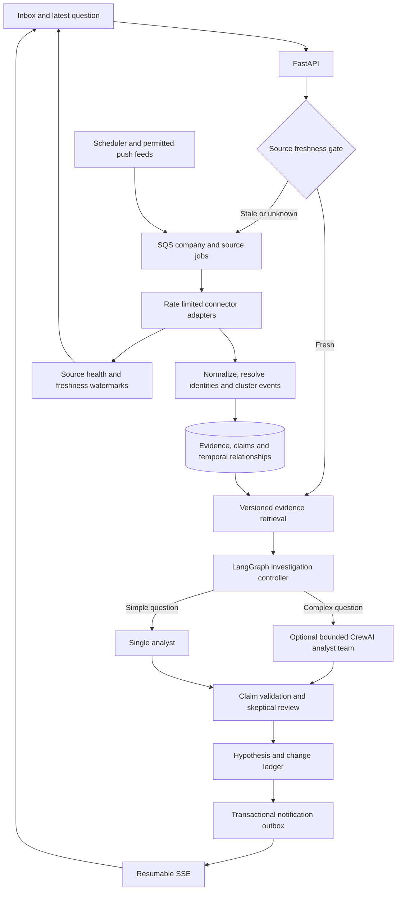

# Atlas product and engineering upgrade plan

Decision date: 29 October 2026. Scope: the complete company-intelligence product in this repository. This is a delivery plan with a code audit, not a declaration that the planned capabilities already exist.

Delivery update, 31 October 2026: the audit table below records the original baseline. Catalog migration, primary SEC/NSE adapters, dated financial qualification, multi-source refresh, record-version history, correction propagation, durable LangGraph checkpoints, monitoring rules and in-app alerts now have implementations. See [IMPLEMENTED_UPGRADE.md](IMPLEMENTED_UPGRADE.md) for tested behavior and remaining limits; future acceptance gates are not implied to have passed.

## Product outcome

At any time, a user can ask what changed for a company, person, sector, or investment theme; receive the latest available collected evidence; see exactly when each source was checked; and inspect a defensible strategy hypothesis with alternatives and disconfirming evidence. India is a first-class market: Reliance operating companies, Jio, Tata companies and trusts, Adani, Mahindra, Bharti, JSW and other groups retain distinct legal identities.

The differentiator is an auditable connection between public statements, commitments and subsequent outcomes. More agents cannot compensate for missing filings, incorrect identities, or stale sources.

## Section-by-section audit

| Area and inspected code | Current behavior | Gap | Upgrade and acceptance condition |
|---|---|---|---|
| Overview: `src/main.tsx` | Demo/live feed, counts, basic search and compact graph | No clustering, freshness summary or breaking-event ranking | Live change inbox with deduplicated event clusters, materiality reasons, collection age and source gaps; an outage never appears as zero company activity |
| Companies: `server/seed.py`, registry builder | 16 seeded companies; unfinished external catalog generator | No catalog migration, financial evidence, pagination or multi-sector membership | Versioned import with stable IDs, merge review, sector/country filters, cursor pagination and explicit qualification; restart upgrades an existing DB without losing watchlists |
| Entity dossier | Description, group label, developments | Missing sourced leaders, owners, investors, advisers, facilities and capital history | Tabbed timeline, people/roles, ownership, deals, technologies, sources and hypotheses; every relationship carries scope and dates |
| People | Two basic person records | No dated role history or monitored-account attribution | Public professional profiles and role intervals, personal versus corporate investments, attributable public statements and disclosed appearances |
| Intelligence graph: `src/Graph.tsx` | Circular layout, accepted edges, pan/zoom | No time filters, path queries, inferred-edge distinction or scaling | Focused subgraph API, two-hop expansion, relation filters, evidence side panel and time slider; load bounded neighborhoods rather than all nodes |
| Strategy radar | Two synthetic hypotheses | Model analysis stays in dossier; no lifecycle or outcome review | Draft/promoted/disputed/resolved hypothesis ledger with source claims, contradictions, horizon and explicit falsification conditions |
| Investigations: `server/intelligence/*` | Routed stored-evidence retrieval and one Groq synthesis call | No refresh-before-answer, durable graph resume, embedding retrieval or claim-level citation verification | Freshness-aware acquisition barrier, historical cutoff, typed claims, bounded specialist review and resumable execution |
| Watchlist | Persistent entity IDs | No priority, cadence, alert rule or bulk groups | Per-watch priority, source set, desired cadence, event rules, country/sector bulk selection and request budget preview |
| Sources: `server/sources.py` | One GDELT headline connector | Primary filings and social feeds are placeholders; latest run is global | Connector interface, per-company cursors, source health, last-success preservation, rate limits, parser versions and capability reporting |
| RAG: `retrieval.py`, `context.py` | Lexical overlap, recency, tier prior, graph expansion and diversity | No indexed text search, semantic vectors, contradiction retrieval or historical replay | Indexed lexical baseline plus optional embeddings fused by reciprocal rank; retrieve opposing claims and filter by both valid and observed time |
| Citation audit | Checks IDs and reports source counts | A valid ID does not prove the sentence is supported; reviews and official sources are conflated | Claim-level source spans and entailment review, explicit source class, reviewer state and unsupported-claim rejection |
| Jobs: `server/worker.py`, `research.py` | SQS, SQLite job snapshots and manifests | Source errors could be acknowledged; workflow snapshots are not resumable checkpoints | Propagate failures, idempotency keys, lease renewal, persisted task cursor, retry classification, poison-message inspection and replay |
| Runtime config: `runtime_config.py` | Secrets Manager startup fetch through IAM | No rotation refresh or typed non-secret configuration | Validated config with precedence, role/tool policies, bounded secret caching and redacted operational output |
| Storage: `server/db.py` | JSON records in SQLite WAL | Full-table reads, no normalized temporal joins or scalable change stream | Normalized PostgreSQL migration before multiple hosts; retain SQLite for one-host pilot; migration and restore rehearsal required |
| AWS: `infra/terraform/*` | Existing EC2, SQS/DLQ, DynamoDB, S3, disabled scheduler | Broad watchlist jobs can exceed a lease; pending Terraform changes are not deployed | Fan out one company/source partition per job, measured lease heartbeat, workload caps, rotated Docker logs, S3 manifests and queue health; no CloudWatch |
| Tests and CI | API, RAG, secret and browser tests | CI previously selected only the API file | Run the entire Python suite and browser/container checks; add outage, duplicate delivery, backpressure and stale-answer scenarios |

## What “real time” must mean

Three timestamps must remain separate: when a publisher released a document, when our connector observed it, and when analysis finished. Freshness is source- and entity-specific. A successful empty poll means no matching items were returned, not that nothing happened globally.

Proposed service targets, subject to upstream availability and measured capacity:

| Path | Proposed target | User experience |
|---|---|---|
| Source supporting push or stream | Process within 60 seconds of receipt at p95 | Live indicator with source availability |
| Priority issuer/regulator polling | Check every 2–5 minutes where allowed | Last checked, next check, and original publication time |
| Broad news discovery | Start with 15–30-minute checks and source backoff | Latest available reporting with a visible collection watermark |
| On-demand latest question | Return cache immediately and queue refresh if stale; proposed 30-second interactive wait budget | Answer marked current, refreshing, stale, or partial; job continues after timeout |
| UI changes | Proposed under 5 seconds after commit via SSE | New-item notice, reconnect/resume cursor and poll fallback |

GDELT describes its core streams as updating every 15 minutes. Faster application polling cannot remove upstream publication or indexing delays. See [GDELT](https://www.gdelt.org/) and [DOC API](https://blog.gdeltproject.org/gdelt-doc-2-0-api-debuts/).

At 1,500 candidates, polling every company every five minutes would request 432,000 company checks per day before retries or additional sources. Therefore registry inclusion must be distinct from active monitoring. Hot watchlists get priority; broad portfolios use permitted batches and lower cadence. UI displays the achieved cadence and coverage.

## Target processing architecture

Every task carries entity IDs, source IDs, dataset, configuration version, retrieval cutoff, run ID and idempotency key. Credentials remain in AWS Secrets Manager and are not agent context.

## Flexible configuration contracts

Store non-secret defaults in versioned configuration with validated workspace overrides. Reject unsupported keys and invalid limits. A config change records who changed it and applies to new runs; an existing run retains its config version.

- Sector taxonomy: stable sector ID, display label, aliases, parent, niche tags and target candidate count. Aerospace adjacency must not imply defence-AI capability; semiconductor adjacency must not imply quantum activity.
- Financial qualification: metric (`valuation` or annual `net_profit`), value, currency, fiscal/as-of date, dated FX source, legal entity, original document and review state. Revenue is a separate metric. Pass when either requested metric exceeds USD 500M; retain unknown and expired states.
- Connector: supported countries and entities, allowed hosts, method, interval, timeout, quota, backoff, cursor strategy, source terms and parser version.
- Watch: priority, active sources, desired max age, daily request allocation, event categories and alert conditions.
- Research policy: mode, maximum evidence age, historical cutoff, context budget, model identifier, maximum calls, wall time, graph hops and allowed tools.
- Agent role: objective, input/output schema, model, tools, delegation permission, iterations and review gate.
- Delivery: in-app events first; external notifications only after explicit user setup and authorization.

## Knowledge database and registry delivery

Entities, roles, documents, claims, events, relationships and hypotheses need distinct records. Use stable entity identifiers (Wikidata ID, CIK, LEI, exchange symbol plus exchange); distinguish mergers, old names, subsidiaries and trusts. Keep candidate merges in a review queue.

Relationships carry source claim IDs, effective interval, observed interval, review state and supersession/retraction links. A source correction invalidates dependent hypotheses and raises a review task. Shared attendance creates an appearance claim, not a meeting claim.

The first delivered snapshot now contains 1,372 distinct source-linked candidates and 100 memberships per broad discovery portfolio, with an offline migration and coverage UI. See `IMPLEMENTED_UPGRADE.md` for delivery status. Niche specialization and financial qualification remain separate verification tasks; never imply that adjacent suppliers are niche specialists. A portfolio can include adjacent suppliers only with the category explicitly shown. Financial eligibility is a separate, source-backed coverage count.

Registry acceptance: deduplicate by stable ID, preserve existing user records/watchlists, include company-name aliases, attach source and retrieval time, report gaps, support multi-sector memberships, and offer paginated server-side search. Generate a reproducible catalog artifact; do not make startup depend on a public SPARQL endpoint.

## CrewAI decision and design

Adopt the role/task/crew concept for complex investigations. Keep LangGraph as the outer controller because this repository already has its routing and failure gates. A CrewAI team is one bounded unit of work behind a provider interface; there must be one owner for retries and checkpoints.

Proposed team:

| Role | Inputs and tools | Required output |
|---|---|---|
| Capital analyst | Reviewed filings, funding claims and ownership paths | Dated commitments, announced versus closed status, missing deal terms |
| Sector analyst | Technical disclosures, patents, hiring and deployments | Capability hypotheses, dependencies, competitor context and source references |
| Skeptic | Analyst claims plus underlying evidence | Unsupported claims, contradictory evidence, competing explanations and checks that could falsify the hypothesis |

The deterministic controller owns final validation. Analysts do not authorize source access or promote graph facts. Agent agreement is not independent corroboration.

First team mode uses three sequential tasks, no recursive delegation, no arbitrary browsing or shell tools, no automatic long-term agent memory, at most one guardrail retry per task, and a configurable total budget. Reserve analysis capacity for interactive users. If the budget or source freshness fails, return a partial dossier with the gap.

Use `output_pydantic` contracts with claim text, evidence IDs, source spans, entity IDs, observed/valid dates, status and alternatives. The skeptic receives raw evidence, not only summaries. Host-owned gates check IDs, dataset, dates and evidence support before acceptance. Store task outputs and metrics in the run artifact, not private model reasoning.

CrewAI's documented production design recommends controlled flows, focused crews, structured output and guardrails. Groq support uses the LiteLLM integration. Validate package/Python 3.14 compatibility in an isolated worker image before changing the existing lockfile. See [production architecture](https://docs.crewai.com/en/concepts/production-architecture), [task contracts](https://docs.crewai.com/en/concepts/tasks), and [Groq integration](https://docs.crewai.com/en/concepts/llms).

CrewAI is now implemented as an optional Python 3.13 worker adapter with a separate lockfile and real-framework deterministic tests. It is disabled by default. Wider rollout still requires comparison against the single-analyst baseline on evidence support, latency and cost.

## Ordered delivery backlog

### P0 — freshness and reliability foundation

Implemented with this plan: per-company freshness read API, preservation of last successful collection on failures, source-name matching when aliases are empty, propagation of collection/analysis failure to SQS retries, completed-analysis replay guard, preservation of evidence snapshots on provider exceptions, API startup preserving durable queue jobs, and full Python suite in CI.

Next: atomic per-source request leases across API and workers; split watchlist messages into company/source jobs; classify transient versus permanent failures; renew SQS leases; add bounded refresh-before-answer with an acquisition barrier. Define `fresh`, `stale`, `refreshing`, `partial`, `error` and `never_collected` response states. Frontend exposes these states and source ages.

Exit gate: interrupted/retried jobs never report a false completed result; no duplicate accepted records or unnecessary repeated model calls; a failed source never acquires a new last-success timestamp.

### P1 — source-backed catalog and primary evidence

Complete catalog/import/migration, qualify financial thresholds, add sector and country filters plus pagination. Add one tested primary disclosure adapter for India and SEC submissions with mapped identifiers. Add permitted issuer feeds. Verify request policies and attribution before enabling each source. Broaden after a 20-company shadow run succeeds.

Exit gate: counts are reproducible with source IDs; user data survives imports; each active company has explicit coverage and unverified financial claims remain visible.

### P2 — temporal evidence and research

Add claim/document tables, event lifecycle, contradiction records and historical cutoffs; implement on-demand refresh; indexed lexical retrieval; evaluated embedding candidate fusion; claim-level citations; resumable workflow checkpoints. Add the optional CrewAI team in an isolated, tested adapter.

Exit gate: replay cannot use evidence learned after the requested cutoff; unsupported sentences fail or are labeled hypotheses; team comparison shows measured benefit.

### P3 — continuous product experience

Add materiality-ranked live inbox, resumable SSE, watch rules, alert outbox, richer dossiers, graph path queries and hypothesis review/outcomes. Trigger new analysis only for material novel evidence; suppress repeated syndicated stories.

Exit gate: reconnect does not lose events, corrections propagate, alert deduplication works, and source outages remain visible.

### P4 — load and operations

Normalize in PostgreSQL before scaling workers across hosts; add backup restore drills, replay tooling, quotas, saturation dashboards and model usage accounting. Use existing EC2 where adequate, S3 artifacts and rotated logs; no CloudWatch or Bedrock. Owner performs Terraform apply and deployment.

Exit gate: ingestion recovers from quota errors and worker crashes under realistic load; restore and queue replay are demonstrated; measured spend and achieved freshness meet an agreed budget.

## Quality and cost gates

Create a labeled evaluation set covering Indian group structures, ambiguous names, personal/corporate investments, announcement versus completion, retractions, syndicated sources, and adverse events. Track retrieval recall, claim support, unsupported statement rate, entity-resolution errors, original-source coverage, stale-answer rate, ingestion lag, analysis latency, calls/tokens and cost per dossier.

Citation-ID validity must be 100%; this is a mechanical check, not a factual-accuracy guarantee. Set factual support targets after a baseline review. Do not publish calibrated numerical strategy probabilities until outcomes support calibration. Compare team versus single analyst on the same frozen evidence and blind human review.

Cost control: one collection per allowed source partition and time window, shared cache, novelty hashing before LLM calls, cheap extraction before deeper research, source/model circuit breakers, bounded tasks and daily budgets. Surface degraded freshness when budgets are exhausted instead of hiding it.
