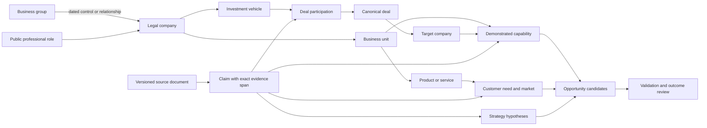
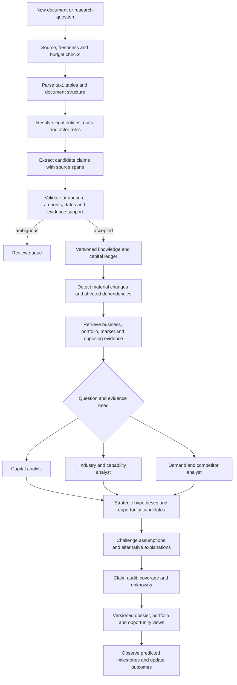

# Atlas V2: company strategy, capital portfolios and business opportunities

31 October 2026 · Proposed implementation plan · Repository: `techieguy-kartik/mind-map`

Canonical checkout: `/Users/apple/Downloads/strategy-mapping`. This document specifies the next product increment. The capabilities below are proposed unless explicitly described as existing. It supplements the earlier product roadmap with the business-unit, portfolio and opportunity models missing from the current application.

## 1. The product decision

Atlas should answer a connected sequence of questions:

1. What businesses does this organization actually operate, for which customers and in which markets?
2. Where is it committing capital, acquiring capabilities, building capacity, partnering, or withdrawing?
3. Which explanations best fit that sequence, its stated priorities, constraints and past execution?
4. What observable action would strengthen or weaken each explanation?
5. Which customer needs or missing capabilities create a credible opportunity for this company, its competitors, suppliers, or a new entrant?

The durable advantage is a history of sourced commitments, execution and outcomes, joined to business capabilities and customer demand. Additional agents help only when their inputs and evaluation improve this chain.

“Mindset” becomes a public-evidence decision profile: stated objectives, observed allocation choices, recurring tradeoffs, execution history and plausible explanations. Private thoughts, undisclosed transactions and complete worldwide activity cannot be recovered from public feeds. Show what is disclosed, what is inferred, and what is unknown in every relevant view.

Three research modes share the same database:

| Mode | Decision the user can make |
|---|---|
| Company strategy | Understand a business unit's direction and the next evidence to watch |
| Capital and portfolio | Trace disclosed investments, holdings, acquisitions, exits and funding relationships |
| Business opportunities | Find a buyer problem, capability shortfall or bottleneck worth validating |

## 2. What the inspected code actually lacks

| Current implementation | Limitation | Required change |
|---|---|---|
| Registry contains company identities and several sector labels | Labels do not describe business units, customers, products, revenue exposure or capability maturity | Add sourced business segments, products, markets and capabilities, with dated classifications |
| `server/financials.py` records valuation and annual net profit | These qualify a company; they do not describe its investment portfolio | Add separate transaction, participation, position and allocation models |
| `server/primary_sources.py` imports recent filing metadata and selected annual facts | It does not parse full filing documents, portfolio tables, transaction exhibits or segment disclosures; its form allowlist omits 13F and Form D | Add bounded backfill, document acquisition and specialized parsers, including amendments |
| GDELT provides headline leads; NSE provides RSS descriptions | Headlines usually lack deal terms, reasons, constraints and execution details | Retrieve permitted primary documents and preserve source spans and tables |
| `retrieval.py` searches direct entities and an existing two-hop neighborhood | A relevant competitor, supplier or technology outside that neighborhood may never be found | Combine entity, business-unit, capability, market, counterparty and contradiction retrieval |
| `router.py` uses general keyword routes | A capital question and a market-gap question need different data and evidence gates | Add typed research intents and domain-specific extraction/retrieval plans |
| Citation audit checks allowed IDs | A valid citation ID does not establish that a sentence or amount is supported | Validate claim-level spans, units, attribution, dates and entailment |
| `alerts.py` uses a small keyword score | It cannot measure a change relative to company size, prior activity or a strategic thesis | Add configurable event materiality and thesis-impact assessment |
| Record history, corrections and LangGraph checkpoints exist | There is no portfolio reconciliation, claim dependency graph or measured forecast history | Extend the existing history into normalized claims and versioned analytical outputs |
| Optional CrewAI capital/sector/skeptic tasks exist | A team reading the same thin evidence cannot produce a complete industry model | Give each task a bounded, typed evidence packet and evaluate its marginal contribution |

Reuse the working authentication, Secrets Manager loader, source budgets, SSE, job recovery, financial observations and source-linked graph. Avoid replacing these merely to introduce another framework.

## 3. Model businesses at several levels

Separate legal identity from how the business operates:

`business group → legal company → business unit / reporting segment → product or service → customer need → market`

A business unit is not necessarily a legal subsidiary. A reported accounting segment can span several legal entities and operational units. Products, brands and funds need their own identities. Preserve mappings and source scopes rather than forcing a one-to-one hierarchy.

Classify each activity along independent dimensions:

- Sector and subsector: a versioned hierarchy with source-backed assignments.
- Value-chain role: research, components, equipment, infrastructure, distribution, software or service.
- Capability: what the company can demonstrably build, deliver, sell or operate.
- Maturity: stated interest, research, pilot, commercial offering, scaled operation, discontinued, or unknown.
- Customer: buyer organization/type and the job or problem being addressed.
- Geography: operating market, project location and regulatory jurisdiction, distinct from headquarters.
- Exposure: revenue, assets, capex or ownership attributable to an activity, only where disclosed. Unallocated amounts stay unallocated.

Multiple sector memberships are expected. Reported interest in AI should not automatically classify the entire organization as an AI producer. A partnership providing access to technology does not establish that the company owns that technology.

The USD 500M valuation-or-annual-profit rule selects **anchor companies**. Their smaller investees, suppliers, competitors, funds and acquisition targets must enter the graph even when they do not qualify as anchors. Otherwise the system systematically misses emerging opportunities.

Initial sector packs should cover:

| Sector family | Example distinctions needed for useful analysis |
|---|---|
| AI and computing | Chips, cloud infrastructure, foundation models, inference, applications, data and distribution |
| Energy and climate | Generation, storage, grid, power electronics, fuels, hydrogen, nuclear and enabling services |
| Mobility and manufacturing | Vehicles, batteries, charging, factories, industrial software, robotics and autonomy |
| Spatial and space intelligence | Mapping, 3D perception, earth observation, satellites and downstream analytics |
| Defence and aerospace | Publicly disclosed platforms, suppliers, software, contracts and procurement milestones |
| Quantum and security | Computing, control systems, sensing, communications and post-quantum security as distinct capabilities |
| Life sciences and bioengineering | Discovery, trials, manufacturing, diagnostics, devices and enabling tools |
| Telecom and connectivity | Networks, equipment, spectrum, enterprise services and standards research; research does not equal a commercial 6G service |
| Additional adjacent domains | Semiconductors, cybersecurity, water, critical minerals, advanced materials, logistics, agriculture/food technology, fintech and financial infrastructure |

Each pack specifies its value chain, evidence sources, metrics, maturity definitions, peer-selection rules and common interpretation errors. Packs are versioned data/configuration, not a separate autonomous agent per company.

## 4. The capital and portfolio ledger

Create four separate records that can reference one another:

1. **Deal:** the round, acquisition, joint venture, asset purchase, divestment, loan or financing event.
2. **Participation:** one named investor's involvement in that deal, with its own disclosed amount and instrument.
3. **Position:** a dated ownership or securities-holding observation. A snapshot is not a transaction record.
4. **Allocation:** a capex, R&D or project commitment, including subsequent spend and execution evidence where available.

Track corporate venture arms, subsidiaries, funds, trusts and disclosed personal/family investment vehicles separately. Store both a fund's manager and the beneficial/economic owner when known; they are different roles. A parent's relationship to a fund does not prove ownership of every underlying investment.

Core ledger fields:

| Field group | Required meaning |
|---|---|
| Parties | Acting legal entity, investor vehicle, target, co-investors, managers and advisers, each with role and attribution evidence |
| Instrument | Equity, secondary shares, convertible, debt, grant, asset acquisition, JV or unknown |
| Amount | Original currency and value/range; amount basis such as round total, investor ticket, enterprise value, equity value, fund target, commitment or actual spend |
| Ownership | Share class, share count, stake percentage, pre/post-transaction basis and voting/economic/control scope where disclosed |
| Time | Announced, filed, effective, closed and first-observed times; fiscal/as-of dates for positions |
| Lifecycle | Reported, announced, signed, approved, closed, amended, terminated, exited or disputed, with supporting claims for each transition |
| Strategic purpose | Explicitly stated rationale separately from analyst inference and alternative explanations |
| Provenance | Document version, page/table/paragraph span, publisher, extraction version, review and dispute state |

Mandatory reconciliation rules:

- A $200M round with five investors is one $200M round. Unknown investor tickets remain null; do not allocate equal shares.
- Do not add an acquisition's enterprise value to the buyer's disclosed cash consideration as though both were additional investments.
- Keep total commitment and amounts disbursed separately. A target fund size is not money already invested.
- Use canonical deal IDs and amendment chains to merge repeated announcements without overwriting history.
- Avoid double counting when aggregating a parent, subsidiaries and investment vehicles. Show aggregation scope and unresolved overlaps.
- Compare positions on compatible share-class and corporate-action bases. A changed holding can reflect splits, transfers or reporting changes; a missing row does not always establish an exit.
- Compare ownership on its actual as-of date. Do not label a reporting-date change as a trade executed today.
- Distinguish holdings reported under investment discretion from beneficial ownership and control. Simple ownership-path multiplication is only an explicitly scoped calculation; unknown layers and overlapping paths prevent a definitive total.
- Record valuation changes and impairment/write-offs independently from new capital flows.

Portfolio screens should show disclosed active holdings, historical positions, pending commitments, completed deals, exits and unknown status. Filters include legal entity/group scope, sector, vehicle, geography, instrument, lifecycle, as-of date and disclosure completeness. Every total declares what it includes.

Add analytics over comparable 30/90/365-day windows: new versus follow-on investments; entries and exits; changes in disclosed sector/geographic exposure; co-investor relationships; capital moving toward a new capability; and commitments that have not reached an observable milestone. Calculate concentration and exposure only over the known, consistently valued portfolio slice and label that denominator. Multi-sector investees require disclosed allocations or an explicitly non-additive membership view; counting their entire investment value in every sector inflates totals.

## 5. Strategic direction as competing, testable explanations

Maintain a versioned strategy profile for each company and important business unit:

- Stated priorities: attributed public statements, annual-report objectives and investor presentations.
- Observed choices: capital allocations, deals, product changes, partnerships, hiring, supplier relationships and exits.
- Execution: announced milestones versus completion, delays, commercial adoption and abandonment.
- Constraints: disclosed financing needs, capacity, permits, customer concentration, distribution, technical dependencies and regulatory exposure.
- Decision patterns: build/buy/partner choices, repeated capability acquisition and capital shifts, with source coverage and time period attached.

Recognize patterns such as vertical integration, a move to adjacent customers, geographic entry, acquiring distribution, reducing supplier dependence, building enabling infrastructure, platform bundling, portfolio concentration, de-risking, or exiting an unsuccessful initiative.

A pattern generates a hypothesis, not a factual edge. Require this output contract:

```yaml
subject: business_unit_or_company_id
question: What strategic direction could explain these changes?
observations: [claim_ids]
stated_rationale: [attributed_statement_ids]
hypothesis: A concise, explicitly inferred explanation
alternatives: [at_least_one_substantive_alternative]
contradictions: [claim_ids_or_explicit_none_found_with_search_scope]
constraints: [claim_ids_and_unknowns]
expected_next_signals: [observable_events_with_time_windows]
disconfirming_signals: [events_that_would_weaken_the_hypothesis]
confidence_basis: Evidence quality, independence, coverage and unresolved ambiguity
as_of: analysis_cutoff
recheck_triggers: [claim_change_or_time_expiry]
```

Use a source independence graph: ten articles repeating one press release are one originating account. An official announcement can verify that a commitment was announced without verifying execution. Record the latter only when execution evidence exists.

Reassess hypotheses after relevant new evidence, corrections or expired observation windows. Keep prior versions and explain the changed evidence. A disclosed professional meeting supports attendance and any published discussion; it does not establish a secret negotiation or completed deal.

Add an evidence-acquisition planner: for each unresolved hypothesis, identify the public disclosure most likely to distinguish it from its strongest alternative, then queue that bounded research task under the source and token budget. For example, an investor presentation may distinguish a commercial partnership from a purely financial stake; a commissioning disclosure may distinguish announced capacity from operating capacity. This is more useful than repeatedly summarizing the same news. Rank tasks by decision relevance, discriminating value, freshness and expected cost; these are transparent prioritization heuristics, not guaranteed information gains.

Treat major developments as event clusters: acquisitions, funding, defaults, recalls, cyber incidents, regulatory action, project cancellations and unexpected execution milestones. Separate novel evidence from repeated coverage. Assess impact using the affected business unit, scale relative to disclosed company metrics, execution stage and explicit dependencies. Propagate a possible impact to connected holdings/suppliers/customers only through sourced relationships, with assumptions exposed; graph proximity alone does not establish causation.

For future-oriented hypotheses, log the statement and cutoff before the outcome, a 30/90/180-day or domain-appropriate horizon, resolution criteria and abstentions. Compare against simple baselines. Numerical probabilities should wait for out-of-time calibration; qualitative confidence should explain its basis rather than imitate a probability.

## 6. A business-gap engine that can support a decision

Treat four kinds of gaps separately:

| Gap | Evidence needed | Useful output |
|---|---|---|
| Company capability gap | A stated/observed objective and a required capability the company lacks, cannot scale or explicitly outsources | Build, buy or partner candidates and a verification task |
| Customer/market gap | A defined buyer problem, demand/budget evidence, and weaknesses in existing substitutes | A customer segment, unmet need and testable proposed offer |
| Value-chain bottleneck | A growth requirement plus a documented capacity, cost, supply, approval or infrastructure constraint | Which enabling supplier/product could benefit and why |
| Execution gap | A commitment or target compared with sourced actual progress and elapsed time | Missing milestone, dependency and a revised strategy hypothesis |

Maintain a fifth, non-opportunity state: **data gap**. No document mentioning a capability means “unknown” unless the search scope and affirmative evidence support a stronger conclusion. A missing internal product can be a rational partner strategy. A crowded market can still have a specific unmet need; a sparse market can lack demand.

Pipeline:

1. Select the market by customer problem, geography and value-chain stage.
2. Establish demand from buyer disclosures, tenders, procurement, repeated operational problems, credible adoption data or user-authorized research. Job postings and patents are supporting signals, not willingness-to-pay evidence.
3. Build a dated competitor/substitute inventory using product documentation and disclosed deployments, including smaller competitors outside the anchor registry.
4. Map requirements to capabilities, access rights, existing suppliers and distribution. Mark each cell observed, inferred, disputed, stale or unknown.
5. Generate candidate gaps from explicit mismatch or bottleneck evidence.
6. Challenge each candidate: existing substitutes, economics, regulation, switching costs, incumbent incentives, missing demand and deliberate non-entry.
7. Rank eligible candidates by separately visible demand, unmet need, strategic fit, feasibility and timing. Keep evidence strength and collection coverage separate from attractiveness. Missing inputs trigger research tasks, not zeroes or invented values.
8. Produce an opportunity brief and the cheapest next validation step. Do not contact buyers or send messages automatically.

Initial promotion policy: a broad market-gap claim needs demand evidence from at least two separate buying organizations, a dated competitor/substitute review and a falsifiable unmet-need statement. A single buyer's documented need can produce an account-specific opportunity, clearly scoped to that buyer. These are proposed review gates, not proof of commercial success.

An opportunity brief includes: who would buy; what they cannot achieve; evidence of pain and budget; existing alternatives; why those alternatives may fall short; potential solution and suppliers; required capabilities; route to market; risks; evidence against; next validation action; and expiry/recheck conditions. Size a market only from sourced inputs or explicitly labeled scenarios, never an invented TAM.

## 7. Example: connecting moves to an opportunity

The following is fictional and illustrates the desired product behavior; it is not an assertion about Jio, Reliance, Tesla or another real company.

Assume company A announces an AI-compute project, signs a power-supply agreement and invests through vehicle V in cooling startup B. A competitor announces a similar project. Several independent buyers publish evidence of cooling or power constraints.

Atlas should produce:

- A capital ledger entry for V's investment in B; ticket size remains undisclosed if only B's round total is known.
- A capability path connecting A's compute project to electricity and cooling requirements.
- A hypothesis that A is addressing infrastructure dependencies, alongside alternatives such as a passive financial investment or an unrelated project.
- A next-signal watch for construction, commissioning, capacity contracts or customer deployments.
- A candidate opportunity in a specific cooling/power service only if buyer demand and shortcomings of existing suppliers are evidenced.
- A rejection or downgrade if an established partner already meets that need, the buyers lack budget, or the compute project is cancelled.

This is the intended improvement: one disclosed transaction changes the portfolio, capability map, strategy hypothesis and opportunity assessment, with every connection inspectable.

## 8. Sources: prioritize evidence density and country coverage

Public availability and automated access are different capabilities. Record an adapter's countries, source classes, authentication, allowed fetch targets, document coverage, backfill range, pagination, quotas, watermark, known publication delay, retention terms and last successful contract test. A country missing a working adapter remains visibly uncovered.

| Priority | Source family | Information sought and boundary |
|---|---|---|
| P0 | Company investor-relations pages, annual reports, earnings presentations and published transcripts | Business segments, capital allocation, risks, subsidiaries, products and explicit management rationale; collect permitted originals and document versions |
| P0 | SEC submissions and documents | Full reports/exhibits, beneficial ownership, transaction notices and insider filings; expand beyond current metadata, add historical backfill and amendments [SEC developer resources](https://www.sec.gov/about/developer-resources) |
| P0 | NSE/BSE disclosures and issuer documents | Announcements, results, shareholding and governance; the current NSE RSS adapter is a starting point, not complete filing access [SEBI filing directory](https://www.sebi.gov.in/curation/corporate_filings.html) |
| P0 | Investor and corporate venture portfolio pages plus target-company announcements | Disclosed investments and strategic rationale; archive snapshots and corroborate ownership/status rather than assuming a portfolio logo is a current stake |
| P1 | SEC Form 13F | Covered manager holdings at quarter end, normally reported within 45 days; not a complete real-time portfolio and not short-position reporting [SEC FAQ](https://www.sec.gov/rules-regulations/staff-guidance/frequently-asked-questions-about-form-13f) |
| P1 | SEC schedules 13D/13G and Form D | Beneficial-ownership disclosures and exempt-offering notices. Parse each form on its own terms; Form D's offering amounts/counts are not a complete named-investor ledger [ownership guidance](https://www.sec.gov/rules-regulations/staff-guidance/corporation-finance-interpretations/exchange-act-sections-13d-13g-regulation-13d-g-beneficial-ownership-reporting), [Form D](https://www.sec.gov/files/FormD.pdf) |
| P1 | CCI combination notices and orders | Disclosed counterparties and review/approval developments; an approval does not by itself establish closing [CCI combinations](https://www.cci.gov.in/public/combination/green-channel) |
| P1 | GLEIF and jurisdictional company registers | Legal identities and relationships; GLEIF's direct/ultimate accounting-consolidating parents are not a complete beneficial-owner map [GLEIF API](https://www.gleif.org/en/lei-data/gleif-api), [relationship definitions](https://www.gleif.org/en/lei-data/access-and-use-lei-data/level-2-data-relationship-record-rr-cdf-2-1-format) |
| P1 | UK Companies House | Registered company information and filings, subject to endpoint availability and credentials [getting started](https://developer.company-information.service.gov.uk/get-started) |
| P2 | EPO OPS and other permitted patent records | Assignees, inventions and legal events; patent activity is not proof of a commercial product. OPS requires registration and has usage conditions [EPO OPS](https://www.epo.org/en/searching-for-patents/data/web-services/ops) |
| P2 | ClinicalTrials.gov and domain regulators | Sponsor, intervention and development milestones for life sciences, with domain-specific interpretation [NLM API announcement](https://www.nlm.nih.gov/pubs/techbull/ma24/ma24_clinicaltrials_api.html) |
| P2 | USAspending and permitted country procurement portals | Buyer demand and contract/award changes; distinguish potential ceilings, obligations and payments [USAspending API](https://api.usaspending.gov/docs/intro-tutorial) |
| P2 | Official product documentation, pricing, permitted career pages and public repositories | Product/capability change and hiring themes; posting churn or a repository does not establish executed spending or delivery |
| Supplemental | GDELT and attributable public social posts | Discovery, statements and public reaction. Bluesky provides public author-feed access; verify account attribution. LinkedIn access remains product/permission dependent [Bluesky](https://docs.bsky.app/docs/api/app-bsky-feed-get-author-feed), [LinkedIn access](https://learn.microsoft.com/en-us/linkedin/shared/authentication/getting-access) |

Global expansion uses a jurisdiction adapter registry: filing authority, exchange, company register, languages, disclosure types and access state. Prioritize countries represented in the active anchor cohort. Do not claim worldwide coverage merely because a global news search returned items. X, Truth Social and other social sources stay capability-gated until their actual access, account mappings and permitted collection are tested; an open-source wrapper does not create missing access rights.

Collect source disclosures once and match them to multiple entities. Where available, use source-wide filings/feeds and local matching instead of one identical request per company. Backfill priority companies for a proposed 24-month baseline, then process increments. Expansion is gated on measured completeness against a known disclosure corpus.

## 9. Knowledge database: contracts before another graph server

Proposed normalized records:

| Record | Essential contents |
|---|---|
| Entity / identifier / role | Legal identity, names/languages, register IDs, dated public roles and merge decisions |
| Business unit / reporting segment / activity | Scope, company mappings, products, sectors, customer markets, maturity and supporting claims |
| Capability / requirement / customer need | Definitions, version, operating context, maturity and source-backed relationships |
| Document / document version / source span | Original link, immutable content hash, publication and acquisition times, language, parsed text/tables, page/offset and parser version |
| Claim / claim version | Subject, predicate, object/value, units, actor role, valid interval, known interval, source spans and review state |
| Event / deal / participation / position / allocation | Canonical event and financial semantics from the ledger specification |
| Hypothesis / opportunity / assessment | Supporting and opposing claims, assumptions, alternatives, status, cutoff and review horizon |
| Dependency / outcome / coverage | Which outputs depend on a claim, outcome resolution, and which source partitions were actually checked |

Use append-only versions for claims and analytical outputs. Derived edges reference claim IDs; a graph edge is a materialized view, not a second conflicting authority. Corrected evidence invalidates dependent portfolios, totals, hypotheses, opportunities and alerts through a transactional outbox. Rebuild from evidence and versioned extraction/aggregation rules.

Track publication, effective/as-of, first observed and analysis times separately. A retrospective answer may use only versions known at its cutoff, including the business classification and ownership model known then. User-maintained merges remain reversible; source aliases and legacy Atlas IDs survive migration.



## 10. AI workflow and retrieval

Keep LangGraph as the durable controller. Use the existing CrewAI adapter for bounded specialist work when evidence complexity justifies it. All tasks share typed contracts; their outputs cannot directly create accepted financial facts.



Retrieval lanes:

1. Exact identity/financial joins for ownership, dates, amounts and event state.
2. Indexed lexical retrieval for names, product terms, contractual language and numbers.
3. Evaluated semantic retrieval for paraphrases and multilingual domain terminology.
4. Bounded graph traversal over typed relationships and business capabilities.
5. Explicit competitor/substitute and counterevidence retrieval outside the existing entity neighborhood.

Fuse candidate rankings, preserve complete table/header context, diversify by originating source and enforce observation-time filters before model synthesis. If the required demand, deal terms or identity evidence is absent, return a specific research gap. Never let an LLM supply a missing numeric value to make a portfolio balance.

Groq remains the LLM provider. Use schema-constrained extraction on supported models, followed by independent application validation. The existing `openai/gpt-oss-20b` can be evaluated for routine extraction; benchmark a larger available Groq model for difficult synthesis only when it improves the labeled evaluation set. Schema conformity does not establish factual correctness. Model compatibility must be checked at deployment. [Groq structured outputs](https://console.groq.com/docs/structured-outputs)

Proposed default budgets: no inference for unchanged documents; at most one routine extraction plus one bounded repair per selected chunk; a deep investigation gets a six-call total budget, including specialist/skeptic calls, with chunk/context limits and no recursive delegation. At the limit, retain partial results and expose the missing work. Account quotas, token budgets and measured cost take precedence over these defaults.

Store source-grounded explanations and assessment outputs, not private model reasoning. Source text remains untrusted content, and document acquisition uses validated provider/issuer hosts, redirect checks, size limits and parser isolation.

## 11. Frontend: make the connections usable

Organize the expanded application into five main workspaces with shared filters for company/group, business unit, sector, geography, time and evidence state:

| Workspace | Main view | Drill-down/action |
|---|---|---|
| Command center | Material changes grouped by event, with collection age and affected thesis | What changed, why it matters, originating evidence, contradictory updates and related opportunities |
| Company and business map | Business units, products, capabilities, roles and dependencies | Select a business unit to compare priorities, capital and execution; switch group versus legal-entity scope |
| Capital and portfolios | Dated holdings, transactions, fund/vehicle links, allocations and exits | Filter active/announced/closed/unknown, inspect a deal's lifecycle, reconcile a displayed total and export source-linked rows |
| Markets and gaps | Capability-by-customer matrix and opportunity board | Compare substitutes, inspect demand evidence, reveal unknown cells, rank candidate gaps, record validation outcomes |
| Strategy lab | Timeline of observations, competing explanations and expected next signals | Compare 30/90/365-day periods, replay an as-of date, inspect a scenario and record whether an expected milestone occurred |

Evidence, source coverage, review queues and settings remain shared utilities. Avoid adding a separate top-level navigation item for every model/table.

Useful interactions:

- “Show me where this group's money moved this quarter,” with separate disclosed commitments and actual payments.
- “Which small companies connect three of this firm's emerging capabilities?”
- “Compare the company's stated priorities with observed spending and execution.”
- “Which competitors already solve this customer problem in India?”
- “Show opportunities weakened by a new competitor launch or cancelled project.”
- “Which portfolio holdings have stale or conflicting ownership evidence?”
- “What changed in the hypothesis since last week, and which source caused the revision?”

Every strategy/opportunity card shows supporting evidence, opposing evidence, unknowns, as-of date and the next check. Graphs load bounded neighborhoods, support typed filters and expose a readable evidence panel. Flow diagrams and totals must display “amount undisclosed” rather than assigning zero or making up edge widths.

## 12. Technical choices and cost discipline

Retain React/TypeScript, FastAPI, Groq, LangGraph, optional CrewAI, SQS, S3, Secrets Manager and Terraform. AWS deployment remains owner-operated. No Bedrock or CloudWatch is introduced.

For this richer model, target PostgreSQL with normalized claims/deals, full-text search and optional pgvector after the repository abstraction and migration are tested. Start with relational adjacency and bounded path queries; add a dedicated graph database only after measured query needs justify another service. [pgvector](https://github.com/pgvector/pgvector)

The existing SQLite app remains usable during development. Migrate on a copy, reconcile IDs/counts/totals, rehearse restore and rollback, and cut over explicitly before writers span hosts. Choose a PostgreSQL container on the existing EC2 host only if measured RAM, disk and operational capacity are adequate; managed database cost/availability is a later owner decision.

Use S3 for permitted original documents, parsed artifacts, manifests and backups. Evaluate Docling for document structure/tables/OCR in an isolated parser worker; use native JSON/XML parsers first for structured filings. Benchmark CPU, RAM and extraction quality before enabling OCR broadly. [Docling documentation](https://docling-project.github.io/docling/)

Keep three work priorities: interactive research, fresh disclosures, and historical backfill. One canonical source fetch can feed many companies. Deduplicate before extraction; cache by document hash plus parser/schema/model version; re-analyze only affected claims and theses. Do not periodically send every company dossier to every agent.

Monitoring tiers are proposed policies, not guaranteed source latency: 20 high-priority anchors with source-permitted frequent checks; 100 broader monitored anchors at lower cadence; the full catalog as discovery with selective refresh. Source-wide feeds reduce requests; advertised freshness always uses achieved watermarks. Maintain document, token, request and queue budgets per day and per source.

Planning example, not a measured bill: 200 changed documents/day × 2 selected extraction chunks × 1 call = 400 extraction calls; 20 deep investigations × up to 6 calls = 120 calls before retries. Multiply measured input/output tokens by current provider rates, then add AWS storage, requests, compute, backup and transfer. Do not assume a free API quota supports this volume. Return deferred work at a configured cap and display the reason.

Use rotated logs, S3 run manifests and a lightweight local metrics endpoint/dashboard. Add heavier metrics storage only when required. Secrets remain in Secrets Manager; snapshot secrets never enter prompts, reports or source artifacts.

## 13. Delivery order: complete vertical slices

Do not implement every connector or launch every specialist at once. The first release should join one primary document to a reconciled deal, a business capability and a source-backed strategy explanation.

| Order | Work package and proposed repo location | Exit condition |
|---|---|---|
| 1 | Contracts and identity: `server/domain/`, `server/storage/`, versioned migrations and sector packs | Business unit is distinct from legal entity; smaller related entities are retained; existing IDs/data survive migration |
| 2 | Original documents: `server/ingestion/`, source manifests, parsing and `source_spans` | A claim opens its exact source page/paragraph/table; backfill resumes without duplicate documents |
| 3 | Capital ledger: `server/capital/`, `GET /api/entities/{id}/portfolio`, `GET /api/deals/{id}` | Fixture rounds, amendments, exits and group aggregation reconcile; unknown tickets remain unknown |
| 4 | Business maps: `server/industry/`, `GET /api/entities/{id}/business-map`, `src/features/business-map/` | Multi-sector firm is explorable by business unit and market with dated capabilities and source links |
| 5 | Strategy profiles: `server/strategy/`, extensions to `server/intelligence/`, strategy-lab UI | An observed move has competing explanations, constraints, next signals and a revision history |
| 6 | Gap research: `server/opportunities/`, `GET /api/opportunities`, markets/gaps UI | Every promoted gap has demand, substitute review, disconfirmers and a validation action; data gaps are distinguishable |
| 7 | Continuous reassessment: transactional outbox, dependency invalidation, coverage policies | New/corrected evidence updates affected portfolio, thesis, opportunity and alert once, with reproducible lineage |
| 8 | Evaluation and expansion: `evals/strategy/`, measured capacity and source tests | Pass reviewed accuracy/cost gates, then expand anchors/countries and domain-specific sources |

API names above are proposed, not existing endpoints. Detailed estimates follow the first parser/ledger slice; source access, document variability and review time dominate schedule uncertainty.

Pilot proposal: 20 anchor entities, beginning with an India-heavy subset such as Reliance Industries, Jio Platforms, Tata Sons, TCS, Tata Power, Tata Motors, Bharti Airtel, Larsen & Toubro, Mahindra & Mahindra, Adani Enterprises, JSW Energy and Sun Pharma; add eight global comparators selected for the first domain packs, for example Microsoft, Alphabet, Amazon, NVIDIA, Tesla, Siemens, Schneider Electric and Samsung Electronics. These are proposed research anchors, not newly verified qualifications or asserted current ownership relationships. Resolve exact legal identity, reorganizations and available source scope before onboarding. Tata trusts, subsidiaries, venture vehicles and smaller counterparties are connected entities with their own evidence.

The first deep domain packs should be AI/compute infrastructure and energy/power dependencies, followed by mobility/manufacturing. They exercise cross-sector reasoning. Add life sciences, defence, quantum and advanced telecom when their specialist evidence and review rules are ready. The larger discovery catalog stays available throughout.

## 14. Acceptance tests and evaluation before calling it intelligent

Create a frozen, human-reviewed evaluation corpus with a proposed starting target of 200 attributed claims, 50 deals/position changes and 20 gap candidates, including rejected opportunities. Expand coverage before interpreting aggregate scores as general accuracy.

Must-pass semantic cases:

1. A subsidiary investment is attributed to the acting entity; the parent's aggregate does not count it twice.
2. A founder's disclosed personal investment is not assigned to a company merely because they lead it.
3. Round total, investor ticket, fund size, valuation and transaction consideration remain distinct.
4. An announced deal later cancelled never becomes a completed holding.
5. A 13F snapshot is not treated as a transaction on its filing date or a complete portfolio.
6. A startup below USD 500M remains discoverable as an investee or competitor.
7. A sector label does not establish a commercial capability; an unknown capability is not presented as an absent one.
8. A patent, hiring increase or public post alone does not establish funded demand or a product launch.
9. Syndicated reports do not inflate independent corroboration.
10. New evidence or revised classifications cannot leak into a historical answer.
11. A correction propagates to derived totals, graphs, hypotheses, gaps and alerts.
12. A persuasive-looking opportunity is rejected when a substitute solves the problem or buyer demand is unsupported.
13. A copied issuer name, fund-manager name or transliteration cannot silently merge distinct legal entities.
14. A valid JSON response with an unsupported assertion fails the claim audit.

Measure attribution precision, numeric/period accuracy, disclosure recall against the labeled source corpus, retrieval recall, claim support, opportunity-review usefulness, alert precision, publication-to-observation lag, cost per accepted claim and time to a useful dossier. Proposed release gates: all critical semantic fixtures pass; every accepted factual claim has an inspectable source span; unsupported factual sentences are rejected or explicitly downgraded; reviewed quality improves over the current single-analyst baseline at a documented cost.

For forecasts, use time-ordered evaluation and archive the sources known at the prediction cutoff. Compare against simple continuation/no-change baselines and report unresolved/abstained cases. Multi-agent agreement is not an evaluation metric.

## 15. Definition of the next useful release

For any onboarded pilot company, the owner can inspect its business units, disclosed portfolio, recent capital changes, competing strategic explanations and related opportunity candidates. Each result exposes its evidence, source coverage, amount semantics and effective dates. The system follows smaller counterparties, updates after new disclosures, handles corrections, and recommends specific missing research.

The next implementation begins with packages 1–3: **identity/business contracts → original documents → reconciled capital ledger**. This establishes the evidence required for meaningful strategy and gap analysis. The visible proof is a portfolio dossier whose numbers reconcile and whose entries link to actual source passages; richer reasoning follows that foundation.
